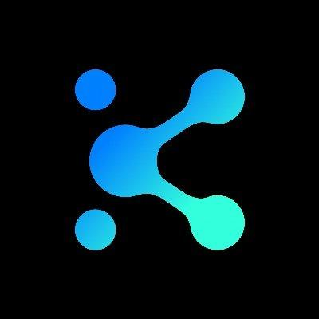

<p align="center">
  
</p>

<h1 align="center">Linkora</h1>

<p align="center">
  <strong>Talk. Share. Connect.</strong><br>
  Private, Peer-to-Peer (P2P) Voice Communication & High-Framerate Screen Sharing Desktop Application
</p>

<p align="center">
  
  
  
  
  
</p>

---

## 🌟 Overview

**Linkora** is a lightweight, Discord-inspired desktop application built for private rooms with friends. Unlike conventional voice platforms that route all your audio and video through centralized media servers, Linkora is built with a **strict P2P-first, zero-media-processing architecture**:

- 🎙️ **Direct P2P Audio**: Audio packets travel directly between peers using WebRTC and Opus at 48kHz. The server never decodes, processes, or stores any audio.
- 🖥️ **Real 1080p Screen Sharing**: Choose between **60 FPS** (gaming), **30 FPS** (standard), and **15 FPS** (low bandwidth) presets with real encoder-level bitrate controls.
- 🔒 **End-to-End Encryption & Transparency**: Media transport is protected by WebRTC DTLS-SRTP, layered with PBKDF2 (100,000 iterations) + AES-GCM-256 frame crypto and an 8-character **Safety Fingerprint (SAS)** for out-of-band verification.
- 👥 **Private Rooms (Max 10)**: Fastify WebSocket signaling handles room presence, rate-limiting, and ICE exchange without ever touching media streams.
- 🛡️ **Zero Media on Server**: Measured signaling server footprint is only `~11 MB` V8 heap / `~61 MB` RSS, making it ideal for free-tier deployments (e.g. Railway).

---

## 🏗️ Architecture

```
[ Client A (Windows) ] <======== Direct P2P (DTLS-SRTP / Encrypted) ========> [ Client B (Windows) ]
         \                                                                           /
          \                                                                         /
     WebSocket (TLS)                                                           WebSocket (TLS)
            \                                                                     /
             v                                                                   v
      +-----------------------------------------------------------------------------+
      |                       Linkora Signaling Server (Fastify)                    |
      |            - Room membership & in-memory peer discovery (Max 10)            |
      |            - Time-limited ephemeral HMAC TURN credential generation         |
      +-----------------------------------------------------------------------------+
                                             | (Fallback relay only)
                                             v
      +-----------------------------------------------------------------------------+
      |                               Coturn Server                                 |
      |                      STUN & Authenticated TURN Relay                        |
      +-----------------------------------------------------------------------------+
```

---

## 🚀 Quick Start

### 1. Running the Pre-built Desktop App
Run the generated binary directly:
```powershell
.\Linkora.exe
```
The application comes pre-configured with the live Railway signaling server (`wss://linkorasignaling-server-production.up.railway.app/ws`).

1. Enter your display name.
2. Enter a private room code (e.g., `gaming-lounge`).
3. Enter your E2EE passphrase and click **Join Voice Room**.
4. Compare your **Safety Fingerprint** with friends to verify end-to-end trust.

---

### 2. Building from Source

#### Prerequisites
- Node.js 20+ LTS
- Rust 1.80+ (`cargo`)
- Python 3 (for dynamic code signing build)

#### Clone & Install
```bash
git clone https://github.com/CRTYPUBG/Linkora.git
cd Linkora
npm install
```

#### Run in Development Mode
```powershell
# Automatically builds libraries and launches signaling + desktop app
.\scripts\dev.ps1
```

#### One-Click Build & Code Signing
Compile and package the standalone Windows executable (`Linkora.exe`) with dynamic Authenticode digital signing:
```cmd
build.bat
```
or
```powershell
python build.py
```

---

## 🧪 Running Automated Tests

Run the complete test suite (Crypto engine, sliding-window replay protection, Fastify signaling server, and 2-client full WebRTC integration tests):

```powershell
.\scripts\test.ps1
```
or
```bash
npm test
```

---

## 🌐 Signaling Server Deployment (Railway / VPS)

The signaling server is designed to run in a container with zero media transcoding load.

### Railway (1-Click Deploy)
1. Fork or push this repository to GitHub.
2. Link your repository in [Railway](https://railway.com).
3. The included `railway.json` and `Dockerfile` will automatically build the service.
4. Set environment variables in Railway:
   ```ini
   PORT=4000
   HOST=0.0.0.0
   NODE_ENV=production
   TURN_SECRET=your_secure_turn_secret_here
   ```
5. Connect your desktop client to `wss://<your-railway-domain>/ws`.

---

## 📁 Repository Structure

```
Linkora/
├── apps/
│   ├── desktop/             # Tauri 2 + React + TypeScript desktop client
│   └── signaling-server/    # Fastify + WebSocket room coordinator
├── packages/
│   ├── shared/              # Zod schemas, protocols, and room constants
│   └── crypto/              # PBKDF2, AES-GCM-256, and sliding-window replay
├── infra/
│   ├── coturn/              # Coturn STUN/TURN configuration
│   └── docker/              # Docker deployment setups
├── docs/
│   ├── ARCHITECTURE.md      # Detailed system architecture & bandwidth physics
│   ├── SECURITY.md          # Cryptographic trust model & E2EE audit
│   ├── DEPLOYMENT.md        # Single VPS & Cloud setup guide
│   └── TESTING.md           # Two-PC real-world verification manual
├── build.bat                # Windows build & code-signing batch script
├── build.py                 # Dynamic code-signing automation
└── docker-compose.yml       # Production docker-compose for VPS
```

---

## 📄 License
This project is licensed under the MIT License.
